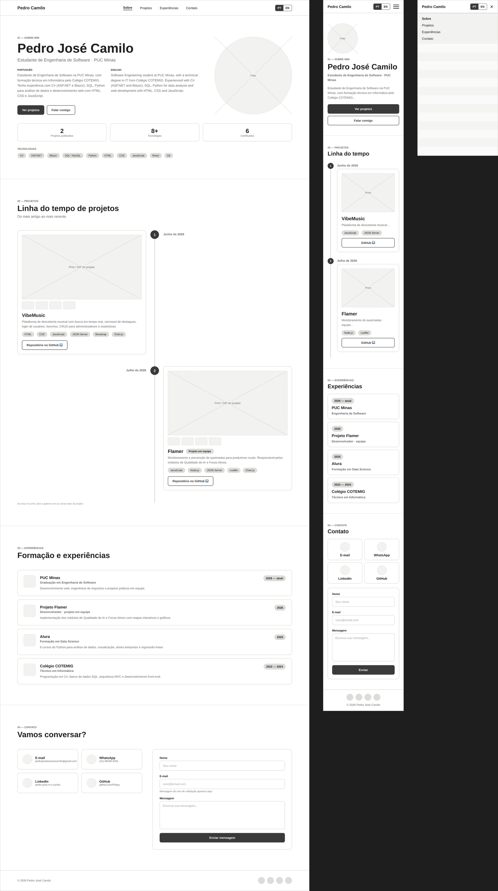
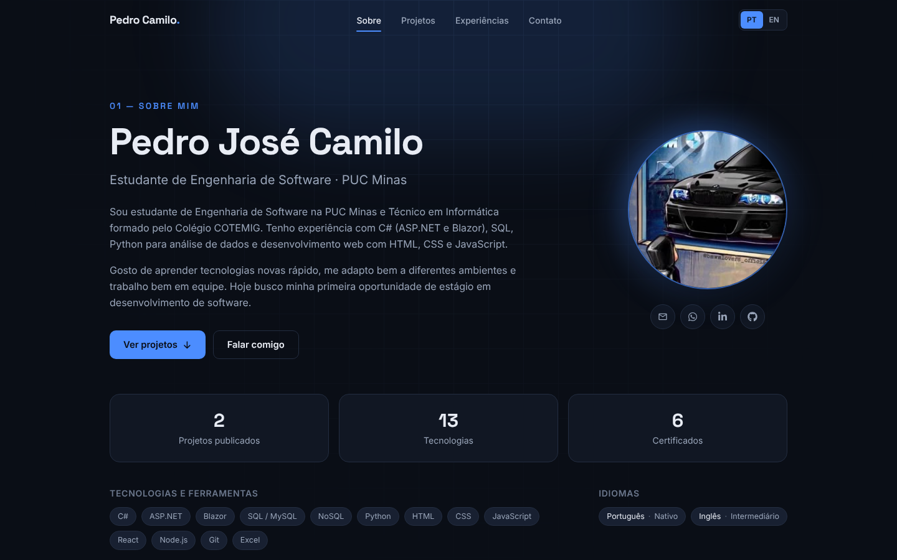
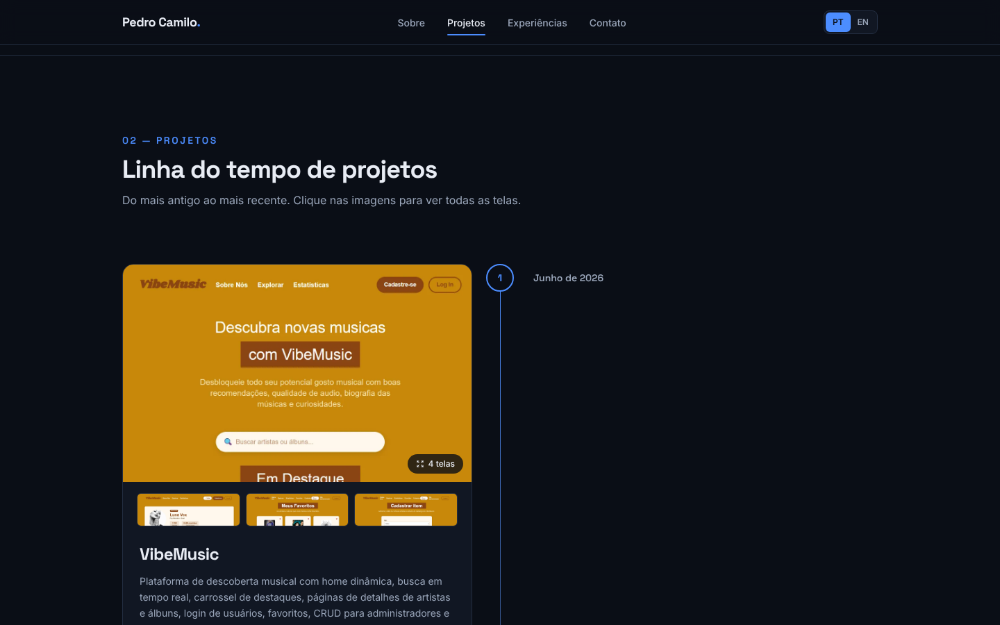
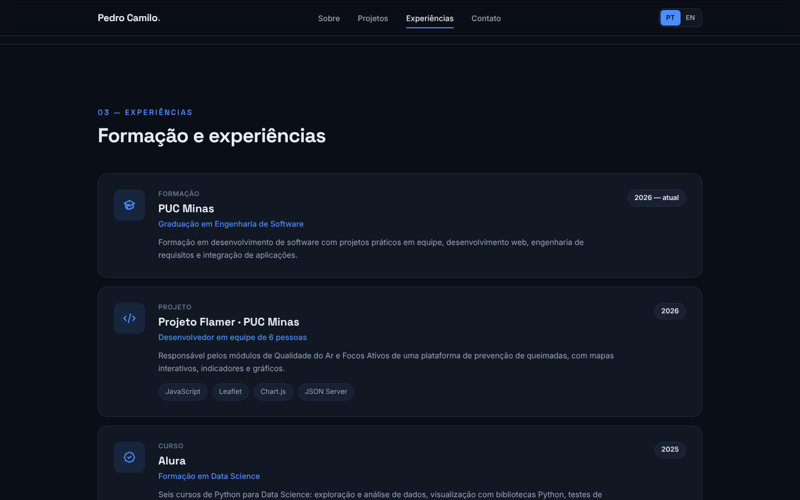
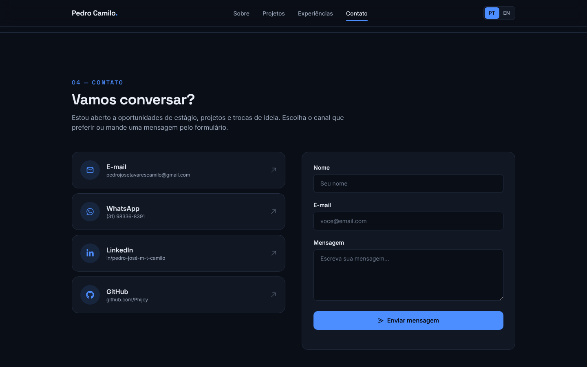
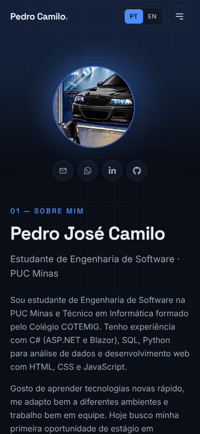
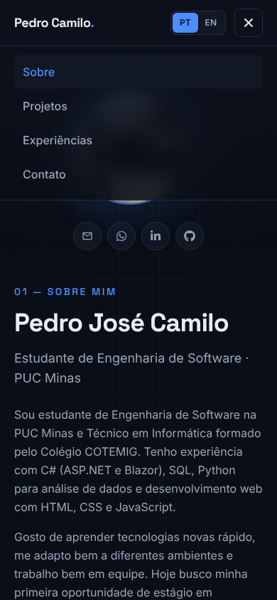

# Portfólio Profissional — Pedro José Camilo 💼

> Website de portfólio profissional, responsivo e bilíngue (PT/EN), com linha do tempo de projetos, experiências e formulário de contato com envio real de e-mail.
>
> 🌐 **Acesse:** https://pedro-camilo-portifolio.vercel.app

<table>
  <tr>
    <td width="800px">
      <div align="justify">
        Este projeto foi desenvolvido no <b>Laboratório 01</b> da disciplina <b>Desenvolvimento e Integração de Aplicações Web (DIAW)</b> do curso de <b>Engenharia de Software da PUC Minas</b>. O objetivo é apresentar minha trajetória, habilidades, projetos e formas de contato de maneira moderna e acessível, em um site publicado gratuitamente na nuvem.
      </div>
    </td>
    <td>
      <div align="center">
        
      </div>
    </td>
  </tr>
</table>

---

## 🚧 Status do Projeto


[](https://pedro-camilo-portifolio.vercel.app)


---

## 📚 Índice

- [Links Úteis](#-links-úteis)
- [Sobre o Projeto](#-sobre-o-projeto)
- [Funcionalidades Principais](#-funcionalidades-principais)
- [Tecnologias Utilizadas](#-tecnologias-utilizadas)
- [Arquitetura](#-arquitetura)
- [Instalação e Execução](#-instalação-e-execução)
- [Deploy](#-deploy)
- [Estrutura de Pastas](#-estrutura-de-pastas)
- [Demonstração](#-demonstração)
- [Testes](#-testes)
- [Documentações utilizadas](#-documentações-utilizadas)
- [Autor](#-autor)
- [Contribuição](#-contribuição)
- [Agradecimentos](#-agradecimentos)
- [Licença](#-licença)

---

## 🔗 Links Úteis

- 🌐 **Site publicado:** [pedro-camilo-portifolio.vercel.app](https://pedro-camilo-portifolio.vercel.app)
- 🎨 **Protótipo no Figma:** [Wireframes do portfólio](https://www.figma.com/design/dg4oqhBoANejbjIByxsy8i/Portifolio?node-id=0-1&t=50rcibEosvjXIEyv-1)
- 💻 **Repositório:** [github.com/Phijey/portifolio](https://github.com/Phijey/portifolio)

---

## 📝 Sobre o Projeto

O portfólio reúne, em uma única página com navegação por âncoras, as informações que um recrutador ou professor precisa para conhecer meu perfil profissional:

- **Por que existe:** centralizar minha apresentação, projetos e contatos em um único link fácil de compartilhar em currículos, LinkedIn e processos seletivos de estágio.
- **Problema que resolve:** projetos acadêmicos ficam espalhados em repositórios sem contexto visual. Aqui cada projeto aparece com descrição, tecnologias, imagens das telas e link para o código.
- **Contexto:** acadêmico (Laboratório 01 de DIAW — PUC Minas), mas pensado para uso real como portfólio pessoal.

---

## ✨ Funcionalidades Principais

- 🧭 **Menu de navegação fixo** com rolagem suave e destaque automático da seção visível (IntersectionObserver).
- 📱 **Menu mobile** que abre e fecha com animação e pode ser fechado com `Esc`.
- 🌎 **Site bilíngue (PT/EN):** todos os textos, inclusive projetos e experiências, mudam de idioma. A escolha fica salva no navegador e o atributo `lang` da página é atualizado.
- 🙋 **Sobre Mim:** apresentação em português e inglês, avatar, indicadores, tecnologias e idiomas.
- 🗂️ **Projetos em linha do tempo dinâmica:** os projetos são lidos de um arquivo de dados e ordenados automaticamente do mais antigo ao mais recente, com nome, descrição, destaques, tecnologias, link do GitHub e imagens.
- 🖼️ **Galeria de imagens** de cada projeto, com navegação por setas do teclado, miniaturas e suporte a prints de página inteira.
- 💼 **Experiências** organizadas com instituição, atividade, período, descrição e tags.
- 📬 **Contato** com ícones clicáveis (e-mail, WhatsApp, LinkedIn e GitHub) e **formulário com envio real de e-mail** via EmailJS.
- ✅ **Validações do formulário** com mensagens de erro em linha nos dois idiomas, estados de envio, sucesso e erro.
- ♿ **Acessibilidade:** link "pular para o conteúdo", foco visível, rótulos nos campos, `alt` nas imagens, navegação por teclado e respeito a `prefers-reduced-motion`.
- 📐 **Design responsivo** testado em celular (375px), tablet e desktop.

---

## 🛠 Tecnologias Utilizadas

### 💻 Front-end

- **React 19** com **TypeScript**
- **Vite 8** (servidor de desenvolvimento e build)
- **Tailwind CSS 4** (estilização)
- **Framer Motion** (animações)
- **React Hook Form** + **Zod** (formulário e validações)
- **EmailJS** (`@emailjs/browser`) para envio de e-mail direto do front-end
- **React Icons** (ícones)
- **Fontsource** (fontes Inter e Space Grotesk hospedadas no próprio site)

### 🖥️ Back-end

O site é estático e não possui back-end próprio. O envio de e-mail é feito pelo serviço **EmailJS**, chamado direto do navegador.

### ⚙️ Infraestrutura & Deploy

- **Vercel** (hospedagem gratuita com deploy automático a cada push na branch `main`)
- **GitHub** (versionamento)
- **Oxlint** (análise estática do código)

### 📦 Dependências

| Pacote | Uso |
| --- | --- |
| `react`, `react-dom` | Biblioteca de interface |
| `framer-motion` | Animações de entrada, menu mobile e galeria |
| `react-hook-form` | Controle do formulário de contato |
| `zod`, `@hookform/resolvers` | Esquema de validação do formulário |
| `@emailjs/browser` | Envio das mensagens do formulário por e-mail |
| `react-icons` | Ícones de contato e da interface |
| `@fontsource-variable/inter`, `@fontsource-variable/space-grotesk` | Fontes do site |

| Dependência de desenvolvimento | Uso |
| --- | --- |
| `vite`, `@vitejs/plugin-react` | Build e servidor de desenvolvimento |
| `typescript`, `@types/*` | Tipagem estática |
| `tailwindcss`, `@tailwindcss/vite` | Estilização |
| `oxlint` | Lint |

---

## 🏗 Arquitetura

Aplicação **SPA (Single Page Application)** com uma única página dividida em quatro seções ancoradas.

- **Dados separados da interface:** todo o conteúdo (perfil, projetos, experiências e contatos) fica em `src/data`. Para adicionar um projeto, basta incluir um objeto no array de `projects.ts`, e a linha do tempo se reorganiza sozinha pela data.
- **Internacionalização própria e leve:** textos da interface ficam em `src/i18n/translations.ts`, e os conteúdos bilíngues usam o tipo `Localized<T>` (`{ pt, en }`). Um Context do React guarda o idioma atual e expõe as funções `t()` (textos da interface) e `l()` (conteúdos bilíngues).
- **Componentes pequenos e reutilizáveis:** `SectionHeading`, `Reveal` (animação de entrada), `ProjectCard`, `Gallery`, `ContactForm` etc.
- **Formulário:** React Hook Form controla os campos, Zod valida, e o EmailJS envia os dados para um template de e-mail. As credenciais ficam em variáveis de ambiente.

**Fluxo de envio do formulário**

```
Usuário preenche → Zod valida (erros em linha) → EmailJS envia → template do EmailJS → e-mail na caixa de entrada
```

**Decisões e trade-offs**

- **Página única em vez de rotas:** deixa a navegação mais fluida e evita configuração extra de rotas na hospedagem.
- **EmailJS em vez de back-end próprio:** zero servidor para manter. Em troca, a chave pública fica visível no navegador, o que é esperado pelo serviço e pode ser limitado por domínio no painel do EmailJS.
- **i18n sem biblioteca:** para apenas dois idiomas, um dicionário tipado é mais simples e leve que uma biblioteca completa.

---

## 🔧 Instalação e Execução

### Pré-requisitos

- **Node.js 20** ou superior
- **npm**
- Conta gratuita no **EmailJS** (apenas para o formulário enviar e-mails)

### 🔑 Variáveis de Ambiente

Copie o arquivo `.env.example` para `.env` e preencha com os dados da sua conta EmailJS:

| Variável | Descrição | Onde encontrar |
| --- | --- | --- |
| `VITE_EMAILJS_SERVICE_ID` | ID do serviço de e-mail | EmailJS → Email Services |
| `VITE_EMAILJS_TEMPLATE_ID` | ID do template de e-mail | EmailJS → Email Templates → Settings |
| `VITE_EMAILJS_PUBLIC_KEY` | Chave pública da conta | EmailJS → Account → General |

```bash
VITE_EMAILJS_SERVICE_ID=service_xxxxxxx
VITE_EMAILJS_TEMPLATE_ID=template_xxxxxxx
VITE_EMAILJS_PUBLIC_KEY=xxxxxxxxxxxxxxxx
```

O template do EmailJS deve usar as variáveis `{{from_name}}`, `{{from_email}}` e `{{message}}`.

> Sem essas variáveis o site funciona normalmente, mas o formulário mostra um aviso de que o envio não está configurado.

### 📦 Instalação de Dependências

```bash
git clone https://github.com/Phijey/portifolio.git
cd portifolio
npm install
```

### ⚡ Como Executar

```bash
npm run dev       # ambiente de desenvolvimento em http://localhost:5173
npm run build     # gera a versão de produção em dist/
npm run preview   # serve a versão de produção localmente
npm run lint      # análise estática do código
```

---

## 🚀 Deploy

O site é hospedado na **Vercel**:

1. Importar o repositório `Phijey/portifolio` em [vercel.com/new](https://vercel.com/new). A Vercel detecta o Vite automaticamente (build `npm run build`, saída `dist`).
2. Em **Environment Variables**, cadastrar as três variáveis `VITE_EMAILJS_*` da tabela acima.
3. Clicar em **Deploy**. A cada novo push na branch `main`, um novo deploy é feito automaticamente.

---

## 📂 Estrutura de Pastas

```
portifolio/
├── docs/
│   ├── prototipo/
│   │   └── wireframes.png        # wireframes de média fidelidade (Figma)
│   └── screenshots/              # capturas do site para este README
├── public/
│   └── favicon.svg
├── src/
│   ├── assets/
│   │   ├── avatar.webp
│   │   └── projects/             # imagens dos projetos (flamer/, vibemusic/)
│   ├── components/
│   │   ├── ContactForm.tsx       # formulário com validação e envio via EmailJS
│   │   ├── Footer.tsx
│   │   ├── Gallery.tsx           # galeria em tela cheia das imagens de um projeto
│   │   ├── Header.tsx            # menu fixo, seção ativa e menu mobile
│   │   ├── LanguageToggle.tsx    # alternador PT | EN
│   │   ├── ProjectCard.tsx
│   │   ├── Reveal.tsx            # animação de entrada ao rolar a página
│   │   └── SectionHeading.tsx
│   ├── data/
│   │   ├── experiences.ts        # experiências e formação
│   │   ├── profile.ts            # perfil, habilidades e contatos
│   │   ├── projects.ts           # projetos da linha do tempo
│   │   └── sections.ts           # seções do menu
│   ├── hooks/
│   │   └── useActiveSection.ts   # identifica a seção visível na tela
│   ├── i18n/
│   │   ├── LanguageContext.tsx   # provider do idioma (com persistência)
│   │   ├── context.ts
│   │   ├── translations.ts       # textos da interface em PT e EN
│   │   ├── types.ts
│   │   └── useLanguage.ts
│   ├── sections/
│   │   ├── About.tsx             # 01 — Sobre Mim
│   │   ├── Projects.tsx          # 02 — Projetos (linha do tempo)
│   │   ├── Experiences.tsx       # 03 — Experiências
│   │   └── Contact.tsx           # 04 — Contato
│   ├── utils/
│   │   └── format.ts             # formatação de datas por idioma
│   ├── App.tsx
│   ├── index.css                 # tema (cores, fontes) e estilos base
│   ├── main.tsx
│   └── vite-env.d.ts             # tipos das variáveis de ambiente
├── .env.example
├── index.html
├── package.json
├── tsconfig.json
└── vite.config.ts
```

---

## 🎥 Demonstração

### 🎨 Protótipo (wireframes no Figma)

Wireframes de média fidelidade nas versões desktop, mobile e com o menu mobile aberto. [Abrir no Figma](https://www.figma.com/design/dg4oqhBoANejbjIByxsy8i/Portifolio?node-id=0-1&t=50rcibEosvjXIEyv-1).



### 🌐 Aplicação Web

**Sobre Mim**



**Projetos — linha do tempo**



**Experiências**



**Contato**



### 📱 Versão mobile

<p>
  
  &nbsp;&nbsp;
  
</p>

---

## 🧪 Testes

O projeto não possui testes automatizados. A qualidade é garantida por:

```bash
npm run lint    # análise estática com Oxlint
npm run build   # checagem de tipos do TypeScript + build de produção
```

Verificações manuais realizadas:

- Navegação pelo menu e destaque da seção ativa em desktop e mobile
- Troca de idioma PT/EN em todos os textos, incluindo mensagens de erro do formulário
- Validação do formulário (campos vazios, e-mail inválido, mensagem curta) e envio de e-mail
- Galeria de imagens com mouse e teclado (setas e `Esc`)
- Layout sem rolagem horizontal em 375px, 768px e 1440px

---

## 🔗 Documentações utilizadas

- [React](https://react.dev/)
- [Vite](https://vite.dev/)
- [TypeScript](https://www.typescriptlang.org/docs/)
- [Tailwind CSS](https://tailwindcss.com/docs)
- [Framer Motion](https://motion.dev/)
- [React Hook Form](https://react-hook-form.com/)
- [Zod](https://zod.dev/)
- [EmailJS](https://www.emailjs.com/docs/)
- [Vercel](https://vercel.com/docs)
- [Figma](https://help.figma.com/)

---

## 👤 Autor

| Nome | GitHub | LinkedIn | E-mail |
| --- | --- | --- | --- |
| **Pedro José Camilo** | [@Phijey](https://github.com/Phijey) | [LinkedIn](https://www.linkedin.com/in/pedro-jos%C3%A9-m-t-camilo-5224352b4) | pedrojosetavarescamilo@gmail.com |

---

## 🤝 Contribuição

1. Faça um **fork** do repositório.
2. Crie uma branch: `git checkout -b feat/minha-melhoria`.
3. Faça commits descritivos: `git commit -m "feat: descrição da melhoria"`.
4. Envie a branch: `git push origin feat/minha-melhoria`.
5. Abra um **Pull Request** explicando o que mudou.

---

## 🙏 Agradecimentos

- **PUC Minas** e ao professor **João Paulo Carneiro Aramuni**, da disciplina de Desenvolvimento e Integração de Aplicações Web, pela proposta do laboratório e pelo template de README.
- Aos colegas da equipe do projeto **Flamer**, apresentado na linha do tempo como projeto em equipe.

---

## 📄 Licença

Este projeto está sob a licença **MIT**. Veja o arquivo [LICENSE](LICENSE).
